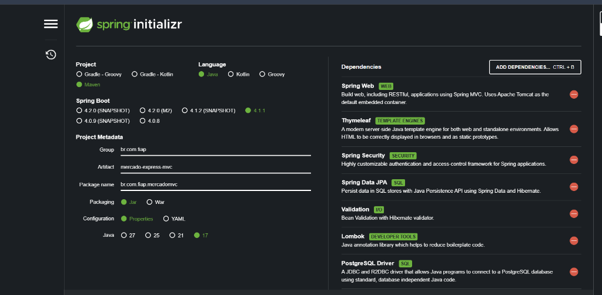

# Mercado Express MVC - Checkpoint 5 (Parte 1)

Aplicação Web completa desenvolvida em Java com **Spring Boot 3 (MVC)**, **Thymeleaf**, **Spring Security 6**, **Spring Data JPA** e persistência em banco de dados **PostgreSQL** para gerenciamento de estoque e catálogo de produtos de um **Mercado Express** (hortifruti, produtos de limpeza, vestuário/meias, brinquedos e mercearia).

Projeto desenvolvido para o **Checkpoint 5 (Parte 1)** da disciplina de Desenvolvimento de Sistemas em Java do curso de Tecnologia em Análise e Desenvolvimento de Sistemas (TDS) — FIAP.

---

## Integrantes do Grupo

- **Curso**: Tecnologia em Análise e Desenvolvimento de Sistemas (TDS) — FIAP
- **Turma**: 2TDSPV
- **Professor**: Dr. Marcel Stefan Wagner
- **IDE Utilizada**: IntelliJ IDEA
- **Integrantes**:
  1. Leandro Guarido de Oliveira — RM: 561760
  2. Kaiky Costa — RM: 564578
  3. Gabriel Costa Solano — RM: 562325

---

## Links do Projeto

- **Repositório GitHub (Spring Security MVC)**: [https://github.com/LeandroGuaridoOliveira/cp5-java.git](https://github.com/LeandroGuaridoOliveira/cp5-java.git)
- **Deploy em Produção**: [https://mercado-express-mvc-90ft.onrender.com](https://mercado-express-mvc-90ft.onrender.com)
- **Plataforma de Hospedagem**: Render (Web Service conteinerizado com Docker)

---

## Tecnologias Utilizadas

- **Linguagem**: Java 17 LTS
- **Framework**: Spring Boot 3.3.2 (Maven)
- **Arquitetura**: Model-View-Controller (Spring MVC) com Thymeleaf
- **Spring Security 6**:
  - Autenticação dinâmica baseada em banco de dados (`CustomUserDetailsService`)
  - Criptografia de senhas com `BCryptPasswordEncoder`
  - Autorização granular por papéis (`ROLE_ADMIN` e `ROLE_USER`)
  - Tela de login customizada com proteção CSRF
  - Tela de **Sign Up (Cadastro de novos usuários)** integrada ao banco
  - Redirecionamento automático pós-login para **Área Restrita**
- **Spring Data JPA / Hibernate**: Mapeamento objeto-relacional para PostgreSQL
- **Banco de Dados**: **PostgreSQL** (com fallback H2 em memória para testes automatizados)
- **Configuração**: `application.yml` com suporte a variáveis de ambiente
- **Validação de Dados**: Jakarta Bean Validation (`@NotBlank`, `@Positive`, `@Size`, etc.)
- **Lombok**: Produtividade e código limpo
- **Front-end**: Bootstrap 5.3, Bootstrap Icons e CSS responsivo
- **Testes Automatizados**: JUnit 5, MockMvc e Spring Security Test (20 testes integrados)

---

## Configuração do Banco de Dados PostgreSQL (`application.yml`)

A configuração do banco de dados está padronizada no arquivo `src/main/resources/application.yml`:

```yaml
server:
  port: ${PORT:8082}

spring:
  application:
    name: mercado-express-mvc

  thymeleaf:
    cache: false

  # Configuração do PostgreSQL para Checkpoint 5
  datasource:
    url: ${SPRING_DATASOURCE_URL:jdbc:postgresql://${DB_HOST:localhost}:${DB_PORT:5432}/${DB_NAME:mercado_db}}
    username: ${SPRING_DATASOURCE_USERNAME:postgres}
    password: ${SPRING_DATASOURCE_PASSWORD:postgres}
    driver-class-name: org.postgresql.Driver

  jpa:
    hibernate:
      ddl-auto: update
    show-sql: true
    properties:
      hibernate:
        format_sql: true
        dialect: org.hibernate.dialect.PostgreSQLDialect
    open-in-view: false
```

---

## Modelagem de Dados

### 1. Tabela de Produtos (`TDS_Sec_MVC_TB_Mercado`)

Mapeada pela classe `br.com.fiap.mercadomvc.model.Produto`:

| Coluna | Tipo BD | Atributo Java | Restrições / Validações |
| :--- | :--- | :--- | :--- |
| `ID` | BIGINT (IDENTITY) | `Long id` | Chave Primária autoincrementada |
| `NOME` | VARCHAR(100) | `String nome` | Obrigatório, entre 2 e 100 caracteres |
| `TIPO` | VARCHAR(50) | `String tipo` | Obrigatório (ex: Produto de Limpeza, Hortifruti) |
| `SETOR` | VARCHAR(50) | `String setor` | Obrigatório (ex: Limpeza, Frutas e Verduras) |
| `TAMANHO` | VARCHAR(30) | `String tamanho` | Opcional (ex: 1.6kg, 500ml, 39-43) |
| `PRECO` | NUMERIC(10,2) | `Double preco` | Obrigatório, valor positivo |

### 2. Tabela de Usuários e Perfis (`TDS_Users_Mercado`)

Mapeada pela classe `br.com.fiap.mercadomvc.model.Usuario`:

| Coluna | Tipo BD | Atributo Java | Descrição / Regra |
| :--- | :--- | :--- | :--- |
| `ID` | BIGINT (IDENTITY) | `Long id` | Chave Primária autoincrementada |
| `NOME_COMPLETO` | VARCHAR(100) | `String nomeCompleto` | Obrigatório, min 3 e max 100 caracteres |
| `USERNAME` | VARCHAR(50) | `String username` | Único, login do usuário |
| `PASSWORD` | VARCHAR(100) | `String password` | Hash BCrypt seguro |
| `ROLE` | VARCHAR(30) | `Role role` | Perfil (`ROLE_ADMIN` ou `ROLE_USER`) |
| `ATIVO` | BOOLEAN | `boolean ativo` | Status da conta (ativo/inativo) |

---

## Spring Security: Autenticação, Sign Up e Controle de Acesso

### Perfis de Acesso (Roles)
1. **`ROLE_ADMIN` (Administrador)**:
   - Acesso total ao sistema: visualização, cadastro, edição e **exclusão** de produtos, além de acesso completo ao painel restrito.
2. **`ROLE_USER` (Usuário Padrão / Operador)**:
   - Operações do catálogo: visualização, cadastro e edição de produtos. **Não possui permissão de exclusão** (retorna 403 Forbidden).

### Matriz de Rotas e Permissões

| Tipo | Rota / Endpoint | Método | Permissão | Descrição |
| :--- | :--- | :--- | :--- | :--- |
| Pública | `/` | GET | `permitAll()` | Landing page inicial (`index.html`) |
| Pública | `/produtos` | GET | `permitAll()` | Catálogo público com busca e filtros |
| Pública | `/produtos/detalhes/{id}` | GET | `permitAll()` | Ficha detalhada do produto |
| Pública | `/login` | GET/POST | `permitAll()` | Tela de login customizada |
| Pública | `/registro` | GET/POST | `permitAll()` | Tela de cadastro de novos usuários (Sign Up) |
| Pública | `/css/**`, `/js/**` | GET | `permitAll()` | Folhas de estilo e scripts |
| **Privada** | `/area-restrita` | GET | `authenticated()` | **Tela restrita pós-login** |
| **Privada** | `/produtos/novo` | GET | `ROLE_USER` ou `ROLE_ADMIN` | Formulário de inclusão |
| **Privada** | `/produtos/salvar` | POST | `ROLE_USER` ou `ROLE_ADMIN` | Persistência do novo produto |
| **Privada** | `/produtos/editar/{id}` | GET | `ROLE_USER` ou `ROLE_ADMIN` | Formulário de edição |
| **Privada** | `/produtos/atualizar/{id}` | POST | `ROLE_USER` ou `ROLE_ADMIN` | Atualização do produto |
| **Privada** | `/produtos/excluir/{id}` | GET | **`ROLE_ADMIN`** | Exclusão restrita ao Admin |

### Credenciais Padrão Pré-Carregadas (`DatabaseSeeder`)

Caso o banco esteja vazio, o seeder inicializa automaticamente os usuários para testes imediatos:

| Login | Senha | Perfil | Nível de Privilégio |
| :--- | :--- | :--- | :--- |
| `admin` | `admin123` | `ROLE_ADMIN` | Acesso Total (CRUD completo + Exclusão) |
| `usuario` | `user123` | `ROLE_USER` | Operador (Visualizar, Cadastrar e Editar) |

Novos usuários cadastrados pela tela de **Sign Up** (`/registro`) são salvos diretamente na tabela `TDS_Users_Mercado`.

---

## Fluxo da Aplicação

1. **Landing Page (`index.html`)**:
   - Apresenta métricas em tempo real, produtos em destaque e links de acesso direto ao catálogo, login ou cadastro.
2. **Tela de Login Customizada (`login.html`)**:
   - Totalmente integrada com Bootstrap 5.3, sem utilizar o formulário padrão do Spring Security.
   - Apresenta alertas de erro e logout, além de link direto para a tela de **Sign Up**.
3. **Tela de Sign Up / Cadastro (`registro.html`)**:
   - Permite que qualquer novo usuário realize seu cadastro informando nome, login, senha, confirmação de senha e perfil.
   - Persiste as credenciais com criptografia BCrypt na tabela `TDS_Users_Mercado`.
4. **Área Restrita (`area-restrita.html`)**:
   - Redirecionamento configurado em `defaultSuccessUrl("/area-restrita", true)`.
   - Exibe o painel com identificação do usuário logado, badge de perfil (`ROLE_ADMIN` ou `ROLE_USER`), detalhamento das permissões, contadores de produtos e atalhos operacionais rápidos.
5. **CRUD Completo de Produtos**:
   - **Create**: Formulário com validação Jakarta em `/produtos/novo`.
   - **Read**: Tabela com filtros de pesquisa por nome em `/produtos` e tela de detalhes em `/produtos/detalhes/{id}`.
   - **Update**: Edição com formulário pré-preenchido em `/produtos/editar/{id}`.
   - **Delete**: Exclusão protegida em `/produtos/excluir/{id}` (restrita ao Administrador).

---

## Como Executar o Projeto Localmente

### Pré-requisitos
- JDK 17+ instalado
- Git

### 1. Clonar o Repositório
```bash
git clone https://github.com/LeandroGuaridoOliveira/cp5-java.git
cd cp5-java
```

### 2. Executar a Aplicação
No Windows:
```cmd
mvnw.cmd spring-boot:run
```
No Linux / macOS:
```bash
./mvnw spring-boot:run
```

A aplicação subirá na porta **8082**:
- Landing Page: `http://localhost:8082/`
- Tela de Login: `http://localhost:8082/login`
- Cadastro (Sign Up): `http://localhost:8082/registro`
- Catálogo de Produtos: `http://localhost:8082/produtos`
- Área Restrita (após login): `http://localhost:8082/area-restrita`

### 3. Executar os Testes Automatizados
```bash
mvnw.cmd test
```
*(Todos os 20 testes de controladores, segurança, autenticação e banco são executados e validados com 100% de sucesso).*

---

## Configuração do Spring Initializr

Dependências configuradas no projeto:
- **Spring Web** (Spring MVC com Tomcat)
- **Thymeleaf** (Template Engine)
- **Spring Security** (Autenticação e Autorização)
- **Thymeleaf Extras Spring Security 6** (Integração de tags de segurança nos templates)
- **Spring Data JPA** (Persistência com Hibernate)
- **Bean Validation** (Jakarta Validation)
- **Lombok**
- **PostgreSQL Driver** (Persistência em PostgreSQL)
- **H2 Database** (Ambiente de testes automatizados)



---

## Estrutura de Arquivos da Entrega (.txt)

O arquivo `integrantes.txt` contém:
- Nome e RM de todos os integrantes
- Link do repositório GitHub com este README detalhado
- Link de deploy ativo no Render
- Plataforma utilizada para o deploy (Render - Docker)
- IDE utilizada (IntelliJ IDEA)