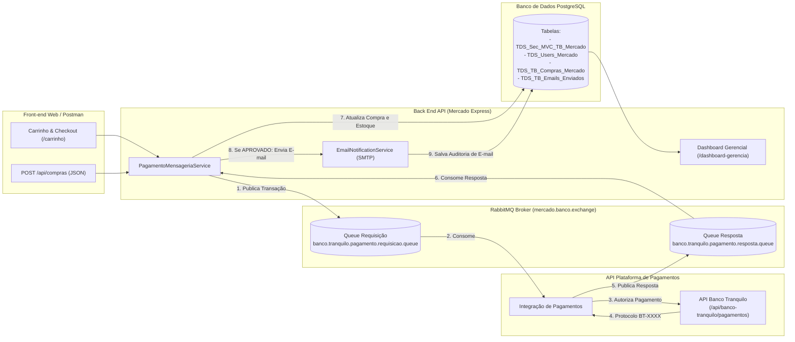
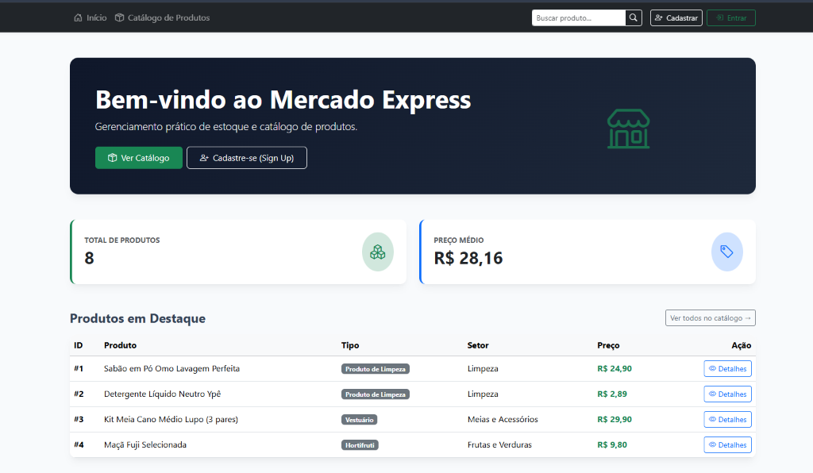
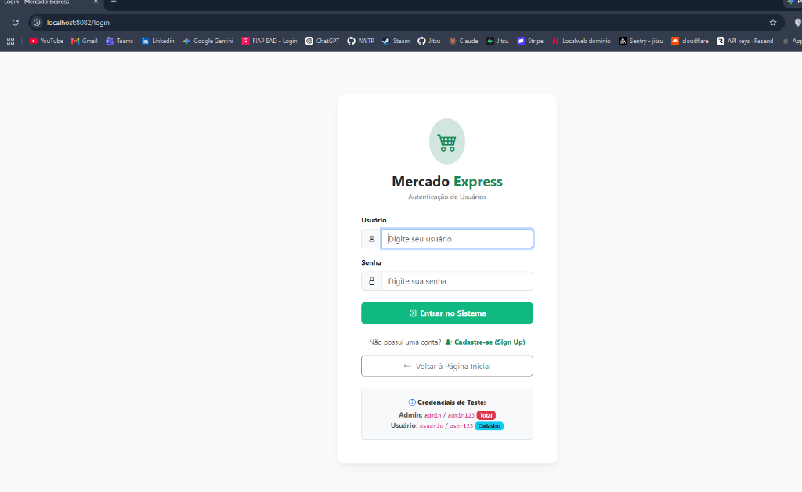
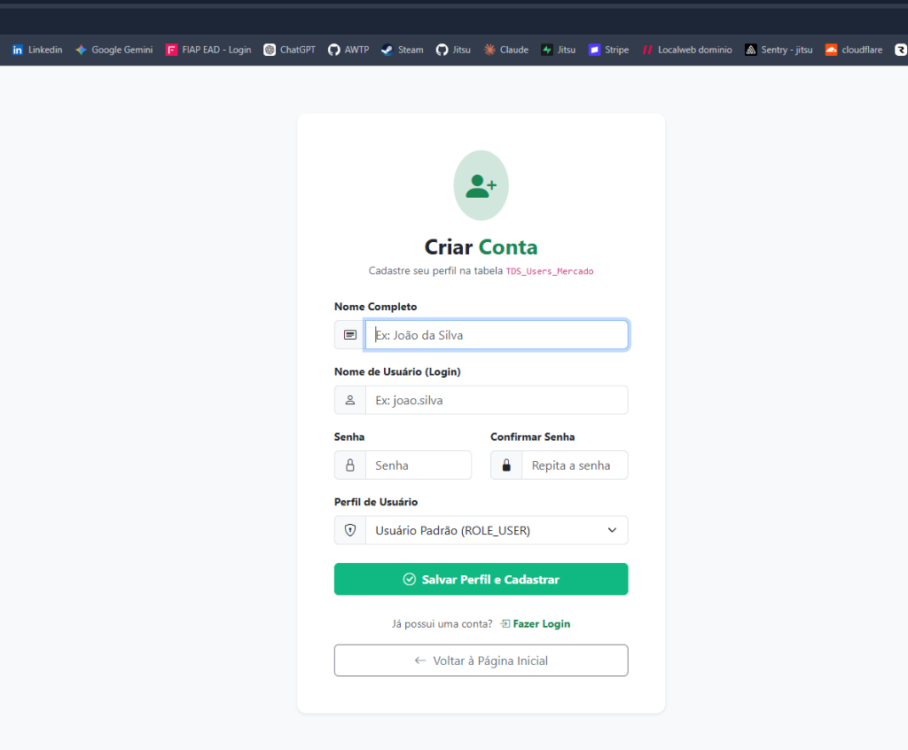
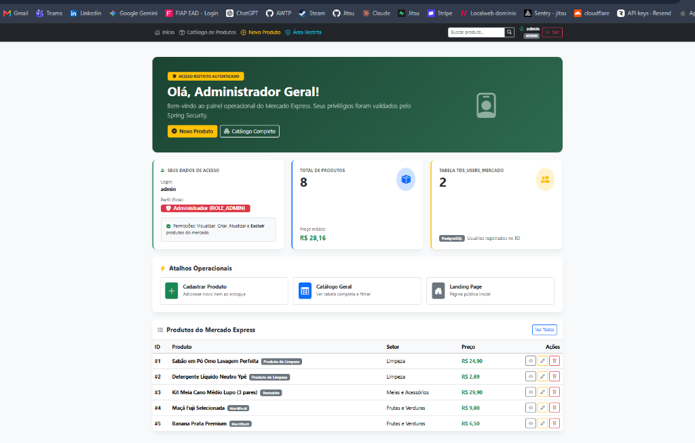
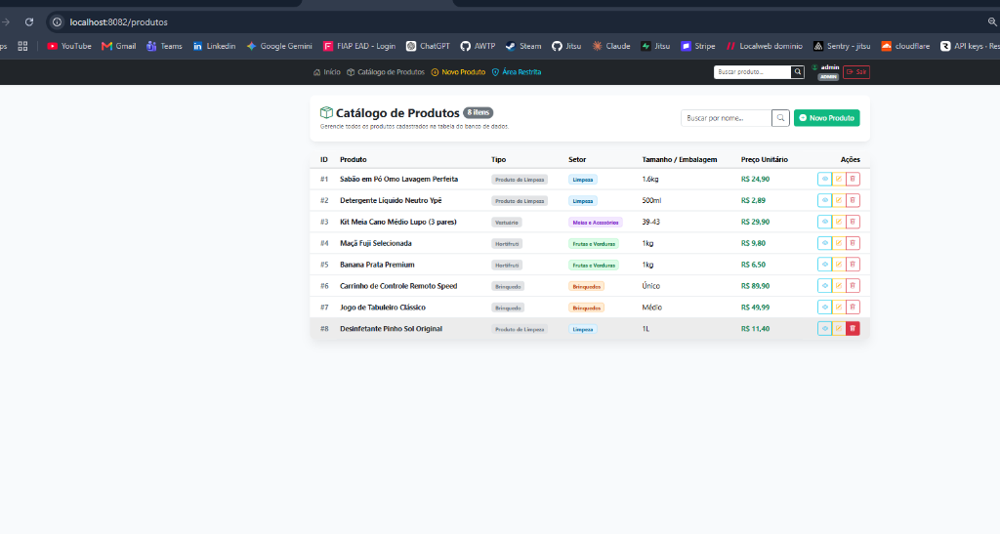
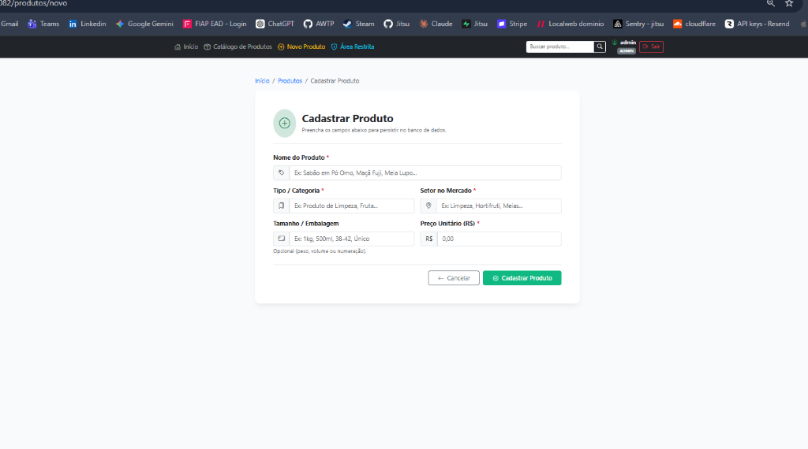
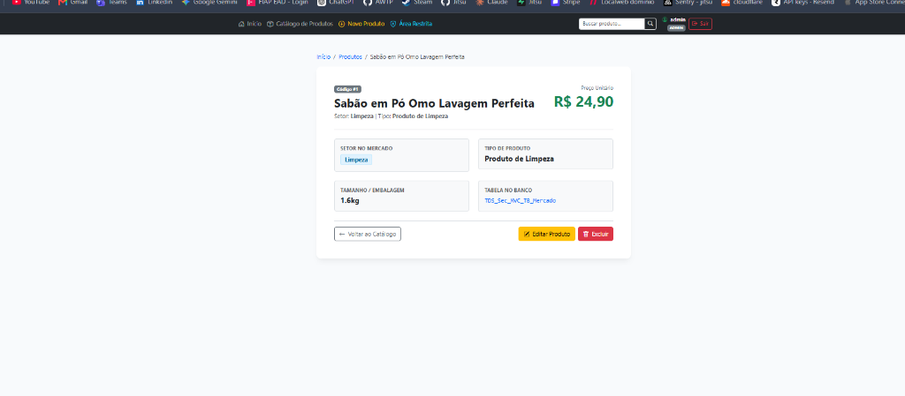

# Mercado Express MVC - Checkpoint 5 (Parte 1 + Parte 2)

Aplicação Web e de Mensageria completa desenvolvida em Java com **Spring Boot 3 (MVC + REST API)**, **Thymeleaf**, **Spring Security 6**, **Spring Data JPA**, **RabbitMQ (AMQP)**, **JavaMail (Envio de E-mail)** e persistência em banco de dados **PostgreSQL** para gerenciamento de estoque, carrinho de compras, integração de pagamentos com a **API do Banco Tranquilo** e **Dashboard Gerencial** de um **Mercado Express** (hortifruti, produtos de limpeza, vestuário/meias, brinquedos e mercearia).

Projeto desenvolvido para o **Checkpoint 5 (Parte 1 e Parte 2)** da disciplina de Desenvolvimento de Sistemas em Java do curso de Tecnologia em Análise e Desenvolvimento de Sistemas (TDS) — FIAP.

---

## Integrantes do Grupo

- **Curso**: Tecnologia em Análise e Desenvolvimento de Sistemas (TDS) — FIAP
- **Turma**: 2TDSPV
- **Professor**: Dr. Marcel Stefan Wagner
- **IDE Utilizada**: IntelliJ IDEA
- **Integrantes**:
  1. Leandro Guarido de Oliveira — RM: 561760
  2. Kaiky Pereira Rodrigues Da Silva — RM: 564578
  3. Gabriel Costa Solano — RM: 562325

---

## Links do Projeto

- **Repositório GitHub**: [https://github.com/LeandroGuaridoOliveira/cp5-java.git](https://github.com/LeandroGuaridoOliveira/cp5-java.git)
- **Deploy em Produção**: [https://mercado-express-mvc-90ft.onrender.com](https://mercado-express-mvc-90ft.onrender.com)
- **Plataforma de Hospedagem**: Render (Web Service conteinerizado com Docker)
- **Vídeo Demonstrativo (YouTube - 5 a 7 min)**: [https://youtu.be/eCYKxEs_vws](https://youtu.be/eCYKxEs_vws)

---

## Parte 2 — Microsserviços e Mensageria com RabbitMQ, API Banco Tranquilo, E-mail e Dashboard

### Arquitetura de Integração (Mercado Express + RabbitMQ + Banco Tranquilo)



### Componentes Implementados na Parte 2

1. **Configuração do RabbitMQ (`RabbitMQConfig.java`)**:
   - **Exchange (Direct)**: `mercado.banco.exchange` (durável)
   - **Queue de Requisição**: `banco.tranquilo.pagamento.requisicao.queue` (Routing Key: `banco.pagamento.requisicao`)
   - **Queue de Resposta**: `banco.tranquilo.pagamento.resposta.queue` (Routing Key: `banco.pagamento.resposta`)
   - Conversão automática de payloads em JSON com `Jackson2JsonMessageConverter`.

2. **API de Integração de Pagamentos — Banco Tranquilo (`BancoTranquiloService.java` e `BancoTranquiloApiController.java`)**:
   - Avalia as transações bancárias (PIX, Cartão de Crédito, Cartão de Débito, Boleto).
   - Gera protocolo bancário oficial (`BT-XXXXXXXX`) e retorna status `APROVADO` ou `RECUSADO` (ex: cartão final `0000` ou valor acima do limite de segurança é recusado para testes).

3. **Envio de E-mail e Persistência no PostgreSQL (`EmailNotificationService.java` e `EmailLog.java`)**:
   - Quando a compra é **confirmada pela API do Banco Tranquilo**, um e-mail de confirmação de pagamento é enviado ao comprador via `JavaMailSender` (SMTP) e **obrigatoriamente armazenado na tabela `TDS_TB_Emails_Enviados` no PostgreSQL** para controle de envios aos clientes.

4. **Tela de Carrinho e Checkout (`CarrinhoController.java` e `templates/carrinho/checkout.html`)**:
   - Permite selecionar produtos do estoque, definir quantidades, visualizar subtotais e acionar a finalização da compra com envio para o **Banco Tranquilo** e emissão de comprovante detalhado (`/carrinho/comprovante/{codigoTransacao}`).

5. **Dashboard Final da Gerência (`DashboardGerenciaController.java` e `templates/dashboard/gerencia.html`)**:
   - Exibe indicadores executivos (Faturamento Total Aprovado, Lucro Líquido Estimado de 35%, Unidades em Estoque, Total de E-mails Enviados).
   - Apresenta **4 gráficos interativos (Chart.js)**:
     1. *Gráfico de Vendas vs. Lucros por Transação (R$)*
     2. *Gráfico de Receita por Meio de Pagamento (PIX, Cartão, Boleto)*
     3. *Gráfico de Controle de Estoque por Produto (Unidades)*
     4. *Gráfico de Distribuição de Estoque por Setor*
   - Lista o histórico completo de compras (`TDS_TB_Compras_Mercado`) e a tabela de auditoria de e-mails enviados (`TDS_TB_Emails_Enviados`).

---

## Exemplo de Requisição JSON para Postman / Insomnia

Arquivo de coleção pronto para importação na raiz do projeto: [`postman_collection_cp5_parte2.json`](./postman_collection_cp5_parte2.json) e script automatizado [`script-testes-api.ps1`](./script-testes-api.ps1).

### 1. Realizar Compra (POST `http://localhost:8082/api/compras`)
**Headers**: `Content-Type: application/json`

```json
{
  "nomeCliente": "Leandro Guarido de Oliveira",
  "emailCliente": "leandro.guarido@fiap.com.br",
  "cpfCliente": "123.456.789-00",
  "metodoPagamento": "PIX",
  "numeroCartao": "",
  "itens": [
    {
      "produtoId": 1,
      "quantidade": 2
    },
    {
      "produtoId": 3,
      "quantidade": 1
    }
  ]
}
```

### 2. Demais Endpoints REST para Testes no Postman / Insomnia
- `GET http://localhost:8082/api/banco-tranquilo/status` — Verifica status da API do Banco Tranquilo e nomes das Exchanges/Queues do RabbitMQ.
- `POST http://localhost:8082/api/banco-tranquilo/pagamentos` — Testa autorização direta na API do Banco Tranquilo.
- `GET http://localhost:8082/api/compras` — Retorna todas as compras salvas na tabela `TDS_TB_Compras_Mercado`.
- `GET http://localhost:8082/api/emails` — Retorna todos os e-mails registrados na tabela `TDS_TB_Emails_Enviados`.

---

## Como Subir o Ambiente Completo (Docker: PostgreSQL + RabbitMQ Management + Mailpit)

O arquivo [`docker-compose.yml`](./docker-compose.yml) sobe toda a infraestrutura da Parte 1 e Parte 2 com um único comando:

```bash
docker compose up -d
```

Serviços disponibilizados pelo Docker Compose:
- **PostgreSQL 16**: `localhost:5432` (Banco: `mercado_db` | Usuário: `postgres` | Senha: `postgres`)
- **RabbitMQ 3.13 + Management Dashboard**:
  - Porta AMQP: `localhost:5672`
  - **Dashboard Web (RabbitMQ Monitor)**: `http://localhost:15672` (Login: `guest` / Senha: `guest`)
- **Mailpit (Servidor SMTP + Webmail para visualizar os e-mails enviados)**:
  - Porta SMTP: `localhost:1025`
  - **Caixa de Entrada Web**: `http://localhost:8025`

*(Caso deseje rodar rapidamente sem Docker instalado, execute `mvnw.cmd spring-boot:run -Dspring-boot.run.profiles=local` para utilizar o banco em memória H2 e fallback automático).*

---

## Tecnologias Utilizadas

- **Linguagem**: Java 17 LTS
- **Framework**: Spring Boot 3.3.2 (Maven)
- **Mensageria**: **Spring AMQP / RabbitMQ** (Exchanges, Queues, Bindings, `@RabbitListener`, `RabbitTemplate`)
- **Notificação por E-mail**: **Spring Boot Starter Mail (`JavaMailSender`)** + Persistência de auditoria no PostgreSQL
- **Arquitetura Web**: Model-View-Controller (Spring MVC) com Thymeleaf + API REST JSON
- **Spring Security 6**:
  - Autenticação dinâmica baseada em banco de dados (`CustomUserDetailsService`)
  - Criptografia de senhas com `BCryptPasswordEncoder`
  - Autorização granular por papéis (`ROLE_ADMIN` e `ROLE_USER`)
  - Tela de login customizada com proteção CSRF
  - Tela de **Sign Up (Cadastro de novos usuários)** integrada ao banco
  - Redirecionamento automático pós-login para **Área Restrita**
- **Spring Data JPA / Hibernate**: Mapeamento objeto-relacional para PostgreSQL
- **Front-end & Gráficos**: Bootstrap 5.3, Bootstrap Icons, **Chart.js 4.4** e CSS responsivo
- **Testes Automatizados**: JUnit 5, MockMvc, Spring Security Test e Spring Rabbit Test (25 testes integrados)

---

## Configuração do Banco de Dados PostgreSQL e RabbitMQ (`application.yml`)

A configuração completa está padronizada no arquivo `src/main/resources/application.yml`:

```yaml
server:
  port: ${PORT:8082}

spring:
  application:
    name: mercado-express-mvc

  thymeleaf:
    cache: false

  # Configuração do Banco de Dados PostgreSQL (Checkpoint 5)
  datasource:
    url: ${SPRING_DATASOURCE_URL:jdbc:postgresql://${DB_HOST:localhost}:${DB_PORT:5432}/${DB_NAME:mercado_db}}
    username: ${SPRING_DATASOURCE_USERNAME:postgres}
    password: ${SPRING_DATASOURCE_PASSWORD:postgres}
    driver-class-name: org.postgresql.Driver

  jpa:
    hibernate:
      ddl-auto: update
    show-sql: true
    properties:
      hibernate:
        format_sql: true
        dialect: org.hibernate.dialect.PostgreSQLDialect
    open-in-view: false

  # Configuração do Broker RabbitMQ (Checkpoint 5 - Parte 2)
  rabbitmq:
    host: ${RABBITMQ_HOST:localhost}
    port: ${RABBITMQ_PORT:5672}
    username: ${RABBITMQ_USERNAME:guest}
    password: ${RABBITMQ_PASSWORD:guest}
    virtual-host: ${RABBITMQ_VHOST:/}

  # Configuração de Envio de E-mail (Confirmação de Pagamento)
  mail:
    host: ${MAIL_HOST:localhost}
    port: ${MAIL_PORT:1025}
    username: ${MAIL_USERNAME:noreply@mercadoexpress.com.br}
    password: ${MAIL_PASSWORD:}
```

---

## Modelagem de Dados (PostgreSQL)

### 1. Tabela de Produtos e Estoque (`TDS_Sec_MVC_TB_Mercado`)
Mapeada pela classe `br.com.fiap.mercadomvc.model.Produto`:
- `ID` (BIGINT PK), `NOME` (VARCHAR 100), `TIPO` (VARCHAR 50), `SETOR` (VARCHAR 50), `TAMANHO` (VARCHAR 30), `PRECO` (DOUBLE), `ESTOQUE` (INTEGER).

### 2. Tabela de Usuários e Perfis (`TDS_Users_Mercado`)
Mapeada pela classe `br.com.fiap.mercadomvc.model.Usuario`:
- `ID` (BIGINT PK), `NOME_COMPLETO` (VARCHAR 100), `USERNAME` (VARCHAR 50 UNIQUE), `PASSWORD` (VARCHAR 100 BCrypt), `ROLE` (`ROLE_ADMIN` / `ROLE_USER`), `ATIVO` (BOOLEAN).

### 3. Tabela de Compras e Transações Bancárias (`TDS_TB_Compras_Mercado`)
Mapeada pela classe `br.com.fiap.mercadomvc.model.Compra`:
- `ID` (BIGINT PK), `CODIGO_TRANSACAO` (VARCHAR 60 UNIQUE), `NOME_CLIENTE`, `EMAIL_CLIENTE`, `CPF_CLIENTE`, `METODO_PAGAMENTO`, `ITENS_RESUMO`, `QUANTIDADE_TOTAL`, `VALOR_TOTAL`, `LUCRO_ESTIMADO`, `STATUS_PAGAMENTO` (`APROVADO`, `RECUSADO`, `PROCESSANDO_FILA`), `PROTOCOLO_BANCO`, `MENSAGEM_BANCO`, `EMAIL_ENVIADO` (BOOLEAN), `DATA_COMPRA`, `DATA_CONFIRMACAO`.

### 4. Tabela de Controle de Envio de E-mails (`TDS_TB_Emails_Enviados`)
Mapeada pela classe `br.com.fiap.mercadomvc.model.EmailLog`:
- `ID` (BIGINT PK), `COMPRA_ID` (BIGINT), `CODIGO_TRANSACAO`, `DESTINATARIO`, `NOME_CLIENTE`, `ASSUNTO`, `CONTEUDO`, `STATUS_ENVIO`, `DETALHE_TECNICO`, `DATA_ENVIO`.

---

## Credenciais Padrão Pré-Carregadas (`DatabaseSeeder`)

| Login | Senha | Perfil | Nível de Privilégio |
| :--- | :--- | :--- | :--- |
| `admin` | `admin123` | `ROLE_ADMIN` | Acesso Total (CRUD completo + Exclusão + Dashboard Gerencial) |
| `usuario` | `user123` | `ROLE_USER` | Operador (Visualizar, Cadastrar, Editar e Dashboard) |

---

## Fluxo da Aplicação e Telas do Sistema (Parte 1 + Parte 2)

### 1. Landing Page (`index.html`)


### 2. Tela de Login Customizada (`login.html`)


### 3. Tela de Cadastro de Usuário - Sign Up (`registro.html`)


### 4. Área Restrita pós-Login (`area-restrita.html`)


### 5. Catálogo de Produtos - Listagem, Estoque e Busca (`produtos/lista.html`)


### 6. Cadastro e Edição de Produtos (`produtos/formulario.html`)


### 7. Detalhes do Produto (`produtos/detalhes.html`)


### 8. Novas Telas da Parte 2
- **Carrinho de Compras e Checkout Banco Tranquilo**: `http://localhost:8082/carrinho`
- **Comprovante de Transação Bancária e E-mail**: `http://localhost:8082/carrinho/comprovante/{codigoTransacao}`
- **Dashboard Final da Gerência (Gráficos de Vendas, Lucros, Estoque e E-mails)**: `http://localhost:8082/dashboard-gerencia`

---

## Como Executar o Projeto e os Testes

### 1. Subir os Containers (PostgreSQL + RabbitMQ + Mailpit)
```bash
docker compose up -d
```

### 2. Executar a Aplicação Spring Boot
```cmd
mvnw.cmd spring-boot:run
```
*(Ou `mvnw.cmd spring-boot:run -Dspring-boot.run.profiles=local` caso não esteja com o Docker aberto).*

### 3. Executar os 25 Testes Automatizados
```cmd
mvnw.cmd test
```